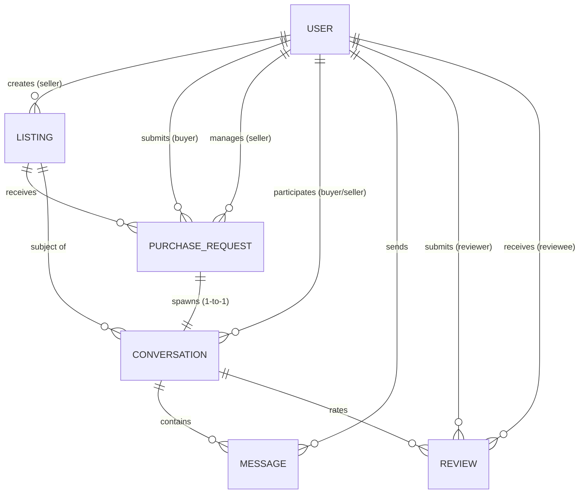

# CampusKart — MongoDB Database Schema Documentation

This document outlines the complete database schema design, entity relationships, collections, and field specifications for the **CampusKart** MERN marketplace platform.

---

## 1. Entity-Relationship (ER) Diagram

---

## 2. Collections & Field Specifications

### 2.1. `users` Collection
Defined in [`backend/models/User.js`](backend/models/User.js). Represents university students registered on CampusKart.

| Field | Type | Required | Default | Description / Constraints |
|---|---|:---:|:---:|---|
| `_id` | `ObjectId` | Yes | Auto | Unique user identifier |
| `name` | `String` | Yes | — | Student's full name |
| `email` | `String` | Yes | — | Thapar university email (`unique`, must end with `@thapar.edu`) |
| `password` | `String` | Yes | — | Hashed password (via bcrypt) |
| `hostel` | `String` | Yes | — | Assigned student hostel (`enum: ['A', 'B', 'C', 'D', 'H', 'J']`) |
| `role` | `String` | No | `'student'` | User role (`enum: ['student']`) |
| `sellerRating` | `Number` | No | `0` | Cumulative average rating received as a seller |
| `sellerReviewCount` | `Number` | No | `0` | Total number of seller reviews received |
| `sellerCompletedTransactions` | `Number` | No | `0` | Total completed transactions as a seller |
| `buyerRating` | `Number` | No | `0` | Cumulative average rating received as a buyer |
| `buyerReviewCount` | `Number` | No | `0` | Total number of buyer reviews received |
| `buyerCompletedTransactions` | `Number` | No | `0` | Total completed transactions as a buyer |
| `createdAt` | `Date` | Auto | — | Timestamp of account registration |
| `updatedAt` | `Date` | Auto | — | Timestamp of last profile update |

---

### 2.2. `listings` Collection
Defined in [`backend/models/Listing.js`](backend/models/Listing.js). Represents products listed by students for sale.

| Field | Type | Required | Default | Description / Constraints |
|---|---|:---:|:---:|---|
| `_id` | `ObjectId` | Yes | Auto | Unique listing identifier |
| `title` | `String` | Yes | — | Product title |
| `description` | `String` | Yes | — | Detailed item description |
| `price` | `Number` | Yes | — | Item price in INR (`min: 0`) |
| `category` | `String` | Yes | — | `enum: ['Electronics', 'Books', 'Notes', 'Cycles', 'Hostel Essentials', 'Study Materials', 'Sports', 'Accessories', 'Other']` |
| `condition` | `String` | Yes | — | `enum: ['New', 'Like New', 'Good', 'Fair']` |
| `images` | `[String]` | No | `[]` | Array of image URLs/paths |
| `seller` | `ObjectId` | Yes | — | Reference to `User` (`ref: 'User'`) |
| `hostel` | `String` | Yes | — | Hostel of the listing (`enum: ['A', 'B', 'C', 'D', 'H', 'J']`) |
| `status` | `String` | No | `'available'` | `enum: ['available', 'sold']` |
| `isDeleted` | `Boolean` | No | `false` | Soft-delete flag (excludes item from marketplace) |
| `createdAt` | `Date` | Auto | — | Creation timestamp |
| `updatedAt` | `Date` | Auto | — | Last update timestamp |

---

### 2.3. `purchaserequests` Collection
Defined in [`backend/models/PurchaseRequest.js`](backend/models/PurchaseRequest.js). Tracks multi-buyer purchase requests and negotiations.

| Field | Type | Required | Default | Description / Constraints |
|---|---|:---:|:---:|---|
| `_id` | `ObjectId` | Yes | Auto | Unique request identifier |
| `listing` | `ObjectId` | Yes | — | Reference to `Listing` (`ref: 'Listing'`) |
| `buyer` | `ObjectId` | Yes | — | Reference to `User` (`ref: 'User'`) |
| `seller` | `ObjectId` | Yes | — | Reference to `User` (`ref: 'User'`) |
| `status` | `String` | No | `'pending'` | `enum: ['pending', 'negotiating', 'accepted', 'rejected', 'cancelled']` |
| `sellerMessage` | `String` | No | — | Optional message or cancellation reason |
| `pendingSellerDecision` | `Boolean` | No | `false` | Set to true when buyer ends negotiation awaiting seller's sale decision |
| `buyerEndedNegotiation` | `Boolean` | No | `false` | Flag indicating buyer ended negotiation |
| `buyerEndedAt` | `Date` | No | — | Timestamp when buyer ended negotiation |
| `createdAt` | `Date` | Auto | — | Request submission timestamp |
| `updatedAt` | `Date` | Auto | — | Last status change timestamp |

---

### 2.4. `conversations` Collection
Defined in [`backend/models/Conversation.js`](backend/models/Conversation.js). Represents an active or closed negotiation chat room between a seller and a buyer.

| Field | Type | Required | Default | Description / Constraints |
|---|---|:---:|:---:|---|
| `_id` | `ObjectId` | Yes | Auto | Unique conversation identifier |
| `purchaseRequest` | `ObjectId` | Yes | — | Unique 1-to-1 reference to `PurchaseRequest` (`unique: true`) |
| `listing` | `ObjectId` | Yes | — | Reference to `Listing` (`ref: 'Listing'`) |
| `buyer` | `ObjectId` | Yes | — | Reference to `User` (`ref: 'User'`) |
| `seller` | `ObjectId` | Yes | — | Reference to `User` (`ref: 'User'`) |
| `status` | `String` | No | `'open'` | `enum: ['open', 'closed']` |
| `closedReason` | `String` | No | — | Reason for chat closure (e.g., sale confirmed, cancelled, item deleted) |
| `createdAt` | `Date` | Auto | — | Chat creation timestamp |
| `updatedAt` | `Date` | Auto | — | Last message or closure timestamp |

---

### 2.5. `messages` Collection
Defined in [`backend/models/Message.js`](backend/models/Message.js). Stores real-time chat messages sent during negotiations.

| Field | Type | Required | Default | Description / Constraints |
|---|---|:---:|:---:|---|
| `_id` | `ObjectId` | Yes | Auto | Unique message identifier |
| `conversation` | `ObjectId` | Yes | — | Reference to `Conversation` (`ref: 'Conversation'`) |
| `sender` | `ObjectId` | Yes | — | Reference to `User` (`ref: 'User'`) |
| `message` | `String` | Yes | — | Message text content |
| `createdAt` | `Date` | Auto | — | Message sent timestamp |
| `updatedAt` | `Date` | Auto | — | Last update timestamp |

---

### 2.6. `reviews` Collection
Defined in [`backend/models/Review.js`](backend/models/Review.js). Stores reputation ratings submitted following negotiations or completed sales.

| Field | Type | Required | Default | Description / Constraints |
|---|---|:---:|:---:|---|
| `_id` | `ObjectId` | Yes | Auto | Unique review identifier |
| `conversation` | `ObjectId` | Yes | — | Reference to `Conversation` (`ref: 'Conversation'`) |
| `purchaseRequest` | `ObjectId` | Yes | — | Reference to `PurchaseRequest` (`ref: 'PurchaseRequest'`) |
| `reviewer` | `ObjectId` | Yes | — | Reference to `User` who authored the review |
| `reviewee` | `ObjectId` | Yes | — | Reference to `User` receiving the review |
| `revieweeRole` | `String` | Yes | — | Role of user being reviewed (`enum: ['buyer', 'seller']`) |
| `interactionType` | `String` | Yes | — | `enum: ['negotiation', 'completed_transaction']` |
| `criteria` | `Map<Number>` | Yes | — | Key-value criterion ratings (1-5 scale) |
| `rating` | `Number` | Yes | — | Overall average rating (`min: 1, max: 5`) |
| `comment` | `String` | No | `''` | Optional review comment |
| `createdAt` | `Date` | Auto | — | Review submission timestamp |
| `updatedAt` | `Date` | Auto | — | Last update timestamp |

**Indexes**:
- Compound Unique Index: `{ conversation: 1, reviewer: 1 }` (enforces at most one review per participant per conversation).
